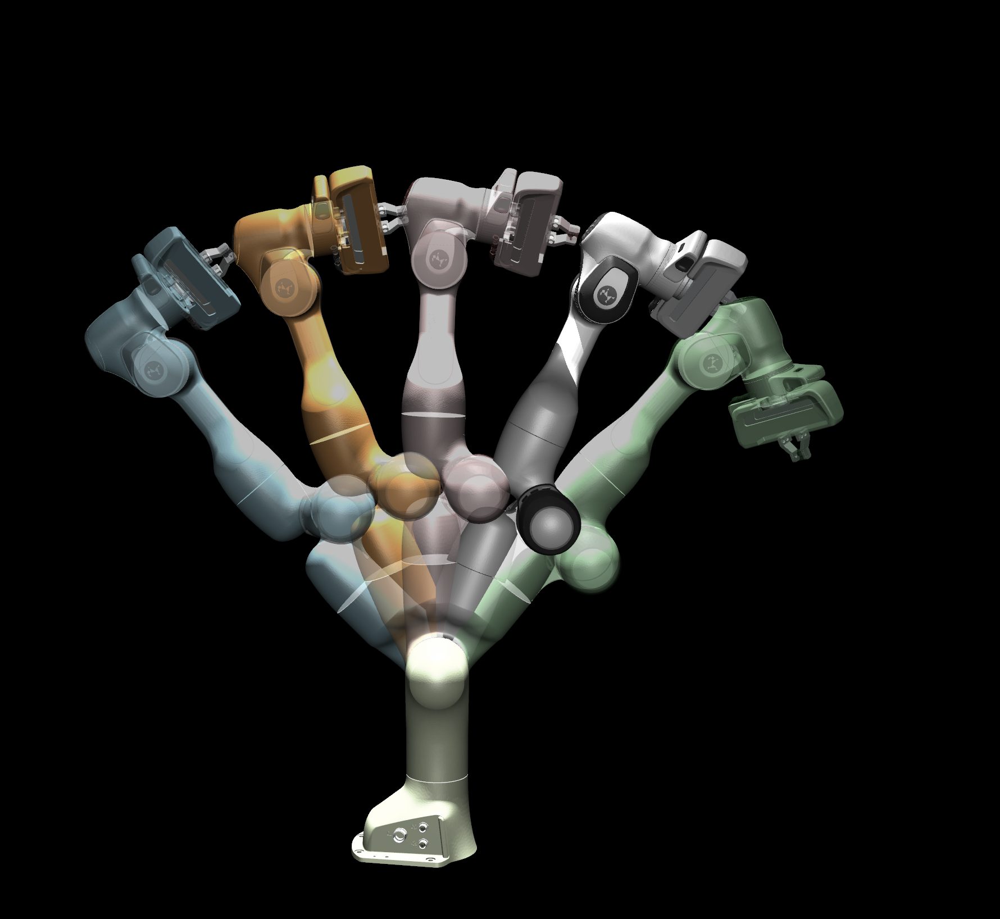
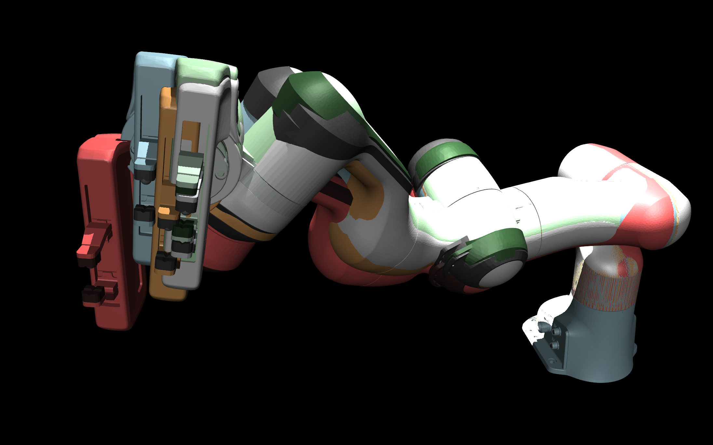
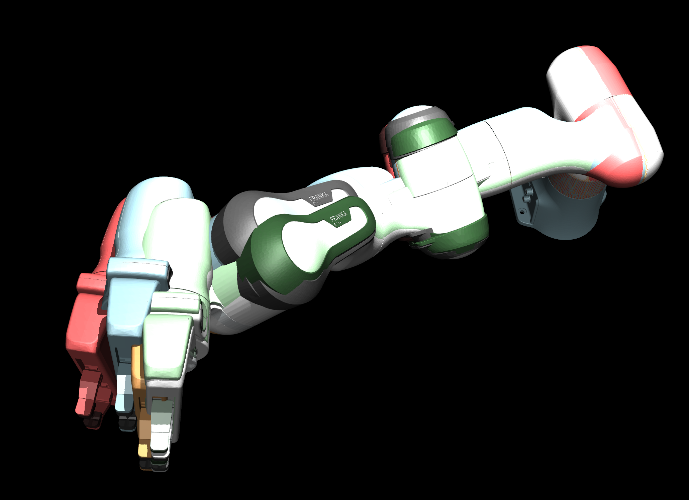

# KNODE Underwater Arm

Learning the hydrodynamics of underwater robotic arms with knowledge-based neural ODEs (KNODE).

<p align="center">
  
</p>

This repository holds the research code for a hybrid dynamics model of a robotic arm moving through water. The model keeps the known rigid-body physics of the arm (from [MuJoCo](https://mujoco.org/) / [MJX](https://mujoco.readthedocs.io/en/stable/mjx.html)) and adds a neural network that learns the extra joint accelerations caused by the surrounding fluid. The whole model is differentiable and is trained end to end through the ODE solver on a GPU with [JAX](https://github.com/jax-ml/jax), [Equinox](https://github.com/patrick-kidger/equinox) and [Diffrax](https://github.com/patrick-kidger/diffrax).

**For the full write-up — background, the math behind each method, and discussion of the results — see the project page: [andrewmasker.com/projects/uw_arm](https://andrewmasker.com/projects/uw_arm.html).**

> **Status:** this project is unfinished. Work stopped when I took a leave of absence from the University of Pennsylvania, so the code is research-grade: it runs, but it contains experimental and superseded files, and the results are limited to the simulated comparison below.

## Results

In simulation, the ground-truth arm is a 7-joint Franka Emika Panda with MuJoCo's fluid model turned on (density 1000 kg/m³), while the nominal model is the same arm without the fluid. Each learned model is asked to predict a held-out trajectory from its initial state and the applied torques. For a fair comparison, the two baselines (Fourier-basis SINDy and a Gaussian process) are trained on the residual between the ground truth and the nominal dynamics, so that, like KNODE, they only have to learn the fluid effects.

<table>
  <tr>
    <td></td>
    <td></td>
  </tr>
</table>

*End point of a validation trajectory from the side (left) and from above (right): ground truth (white), KNODE (green), Fourier-basis SINDy (orange), GP (blue), and the nominal model without the fluid (red). The KNODE prediction nearly overlaps the ground truth, while the others drift away from it.*

## How the model works

The arm's state is $x = [q, \dot q]$. The nominal model gives the joint accelerations of the arm in air, and a residual network adds a learned correction:

$$
\ddot q = \ddot q_{\text{MJX}}(q, \dot q, \tau) + W\, f_\theta(q, \dot q, \tau)
$$

where $f_\theta$ is an MLP (inputs and outputs normalized by the joint, velocity and torque ranges) and $W$ is a learned mixing matrix. The state is integrated with Diffrax, and the loss is a weighted MSE between the predicted and ground-truth joint positions and velocities over the trajectory, so no numerical differentiation of the data is needed. Only the MLP and $W$ are trained; the physics model is fixed.

See [docs/code_overview.md](docs/code_overview.md) for a map of the code.

## Repository layout

| Folder | Contents |
| --- | --- |
| `Core/` | Dataset generation, model definitions (KNODE, Fourier SINDy, GP), training scripts, the test suite and the comparison viewer |
| `Utils/` | MuJoCo/MJX helpers, a reverse-mode-differentiable MJX forward pass, residual-dataset generation, loss plotting |
| `Library/` | JSON specification files for every dataset, model, training run and test, plus the MuJoCo models (`XML_Models/`) |
| `Models/` | Saved trained models (`model.eqx` plus the options used to train them) |
| `Test_Outputs/` | Plots and statistics written by the test suite |
| `Datasets/` | Generated trajectory datasets in [Zarr](https://zarr.dev/) format (**~9 GB**) |
| `Misc/` | Development notes and older requirement snapshots |
| `Tests/` | A small script to open a MuJoCo model in the viewer |

## Getting started

### Cloning without the datasets

`Datasets/` is about 9 GB of Zarr chunks (millions of small files). If you only want to read the code, a sparse, blobless clone skips it:

```bash
git clone --filter=blob:none --sparse https://github.com/AndrewMasker/KNODE_UW_ARM
cd KNODE_UW_ARM
git sparse-checkout set Core Utils Library Misc Tests docs
```

Add `Models` and/or `Test_Outputs` to that list if you want the trained models or the saved plots. Note that loading a trained model also reads the matching dataset's metadata, so running the evaluation scripts needs `Datasets/` too (or a regenerated dataset; see [docs/usage.md](docs/usage.md)).

### Environment

The code was developed with Python 3.12, JAX 0.9 with CUDA 13 on an NVIDIA GPU, MuJoCo/MJX 3.4, Equinox 0.13, Diffrax 0.7 and Zarr 3. `reqs.txt` is a full `pip freeze` of that environment (it includes some unrelated editor packages):

```bash
python3 -m venv .venv && source .venv/bin/activate
pip install -r reqs.txt
```

Every script is run as a module **from the repository root**, because paths to `Library/`, `Datasets/` and `Models/` are relative to the working directory:

```bash
python3 -m Core.Dataset_Generation dataset_3_fluid_no_coll_specs   # generate data
python3 -m Core.Train_Model_Old -m model_fluid_old -t training_fluid_old   # train KNODE
python3 -m Core.Test_Suite_C5 -t test_old                          # evaluate
```

[docs/usage.md](docs/usage.md) walks through the full pipeline, including the SINDy and GP baselines and the comparison viewer used for the figures above.

## Underwater vehicle-manipulator variant

Files ending in `_UVMS` extend the same approach to an underwater vehicle-manipulator system: a free-floating BlueROV2 with small manipulator arms attached (`Library/XML_Models/bluerov2_arm.txt`). That model also integrates the vehicle's position and its orientation as a quaternion. This branch of the work was at an earlier stage when the project stopped.

## References

- R. T. Q. Chen et al., [Neural Ordinary Differential Equations](https://arxiv.org/abs/1806.07366), NeurIPS 2018.
- T. Z. Jiahao, M. A. Hsieh, E. Forgoston, [Knowledge-based learning of nonlinear dynamics and chaos](https://arxiv.org/abs/2010.03415), Chaos 2021.
- K. Y. Chee, T. Z. Jiahao, M. A. Hsieh, [KNODE-MPC: A Knowledge-based Data-driven Predictive Control Framework for Aerial Robots](https://arxiv.org/abs/2109.04821), RA-L 2022.
- S. L. Brunton, J. L. Proctor, J. N. Kutz, [Discovering governing equations from data by sparse identification of nonlinear dynamical systems](https://www.pnas.org/doi/10.1073/pnas.1517384113), PNAS 2016.
